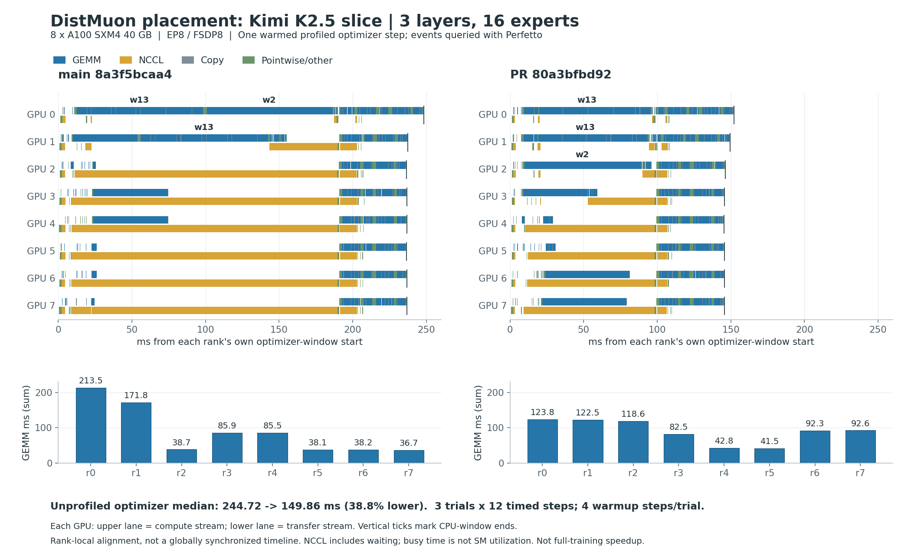
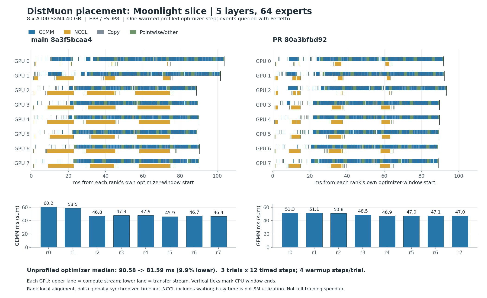

# DistMuon placement: 8-A100 evidence for PR #5468

Question: does joint Owned/Shard/BlockShard placement shorten the optimizer
critical path, and does the trace show the expected movement of computation?

Yes for both measured slices. K2.5 optimizer latency fell **38.8%** and Moonlight
fell **9.9%**. The K2.5 trace moves `layers.0.feed_forward.w2.weight` from rank 0
to rank 2; rank 0's GEMM sum falls from **213.48 to 123.83 ms**. Total estimated
Newton-Schulz work and aggregate remote-send bytes are unchanged. This supports
load balancing as the mechanism, not fewer matrix operations or less payload.

These are optimizer-only measurements, **not full-model training speedups**.

## Scope and versions

- Capture: 2026-10-17, one node, 8 NVIDIA A100-SXM4-40GB GPUs, NVLink (NV12
  between every pair), driver 580.95.05.
- Python 3.12, PyTorch `2.16.0.dev20261016+cu130`, torchvision
  `0.30.0.dev20261016+cu130`; dependencies from the compared source revision.
- Baseline main snapshot: [`8a3f5bcaa4fd51ea6af6fb4bbb90ef03bcb139d0`](https://github.com/pytorch/torchtitan/commit/8a3f5bcaa4fd51ea6af6fb4bbb90ef03bcb139d0).
- PR code: [`80a3bfbd92f7b523551edd34a168f5cc8d2ca710`](https://github.com/JavaZeroo/torchtitan/commit/80a3bfbd92f7b523551edd34a168f5cc8d2ca710).
  Later documentation changes do not change this measured implementation.
- Production model/optimizer factories, EP8/FSDP8, BF16 compute, seed 42,
  deterministic mode enabled (`deterministic_warn_only=False`). No later RFC
  scratch, CUDA-graph, chunking or cross-parameter batching optimizations.
- Kimi K2.5: 3 layers, 16 experts per MoE layer, dim 7168, dense hidden 18432,
  expert hidden 2048. Moonlight: 5 layers, 64 experts, dim 2048. Both retain
  production matrix shapes but reduce layer/expert counts; text-only, vocab 4096.

## Unprofiled timing and layout measurements

Each trial has 16 optimizer steps: 4 warmup, then 12 measured steps. For each
step take the maximum synchronized wall time across 8 ranks; take the median
of those 12 values, then the median of the 3 trial medians. Trial order is
base/PR, PR/base, base/PR. Synthetic gradients are identical across variants.
Only DistMuon runs in the timed region; gradient generation, barriers and
model forward/backward are excluded. CUDA synchronization after the optimizer
is included. Step 17 is profiled only in trial 1 and is excluded from timing.

| Workload | main ms | PR ms | Reduction | NS FLOPs max/mean, main -> PR | Optimizer-phase peak GiB, main -> PR |
|---|---:|---:|---:|---:|---:|
| K2.5 slice | 244.72 | 149.86 | 38.8% | 2.505 -> 1.440 | 5.478 -> 5.191 |
| Moonlight slice | 90.58 | 81.59 | 9.9% | 1.206 -> 1.051 | 4.207 -> 4.147 |

| Trial | K2.5 main ms | K2.5 PR ms | Moonlight main ms | Moonlight PR ms |
|---|---:|---:|---:|---:|
| 1 | 244.721 | 149.866 | 90.579 | 81.520 |
| 2 (reversed order) | 244.493 | 149.862 | 90.710 | 81.593 |
| 3 | 244.730 | 149.519 | 90.456 | 81.688 |

Memory is the maximum allocated memory during the optimizer phase over all
ranks/timed steps, not full-training peak or device reserved memory. Values
are identical across the three trials. NS work is calculated from the actual
local matrix views: `2 * B * ns_steps * s^2 * (2*l + s)`, where `s=min(R,C)`
and `l=max(R,C)`. It is an arithmetic cost estimate, not a hardware counter.

Aggregate remote-send payload (both redistribution directions, excluding
self-copies) is **2357.36 MiB -> 2357.36 MiB** for K2.5 and
**553.44 MiB -> 553.44 MiB** for Moonlight. Endpoints change; these totals do
not prove that communication duration, per-peer traffic or topology cost is
unchanged.

## Trace comparison





The plots are rendered from actual Perfetto-exported kernel/copy intervals,
not schematic bars. Both variants use the same scale within a workload. Each
rank is aligned to its own CPU `DistMuon/optimizer_window` start: do not infer
globally synchronized cross-rank start times. Profiler overhead is visible,
especially for Moonlight, so the speedup above comes from unprofiled trials.

| K2.5 trace observation (one warmed step) | main | PR |
|---|---:|---:|
| Rank 0 CPU optimizer window, ms | 248.26 | 152.18 |
| Rank 0 GPU busy interval union, ms | 240.79 | 146.55 |
| Rank 0 GEMM sum, ms | 213.48 | 123.83 |
| Rank 1 GEMM sum, ms | 171.79 | 122.49 |
| Rank 2 GEMM sum, ms | 38.68 | 118.64 |
| `layers.0.feed_forward.w2.weight` compute rank | 0 | 2 |
| `w2` GPU annotation span, ms | 87.37 | 80.78 |
| `layers.0.feed_forward.w13.weight` compute ranks | 0, 1 | 0, 1 |

The two large dense-FFN matrices no longer serialize on rank 0. The `w2`
annotation encloses its GPU work; it is not a pure GEMM sum. Long NCCL kernels
on lighter ranks shorten too, but NCCL duration includes waiting/spinning and
is **not measured network-transfer time**. Concurrent streams overlap, so
kernel-family sums must not be added and called device wall time. Busy union
uses merged intervals; it is not SM occupancy or utilization.

## Numerics and tests

- All **3,312 parameter/momentum SHA-256 comparisons** match across both
  optimizer workloads, 3 trials and 8 ranks. Trial 1 digests are after the
  additional profiled step; other trials are after step 16.
- Separate real training: 6-layer Kimi debug text model, 8 experts, sequence
  256, EP8/FSDP8, C4 test data, 40 steps, seed 42 and deterministic mode.
  All **40 recorded loss values and 40 grad_norm values match exactly**;
  **32,640 per-step parameter/momentum digest comparisons** also match.
- First/last recorded loss: 8.8392953873 / 6.3774490356; first/last grad_norm:
  3.8367636204 / 6.0888504982. Maximum absolute differences are zero.
- The PR adds one core CPU regression. It fails on baseline and passes on
  the PR; all 9 focused CPU tests pass. Existing 7 GPU unit cases were skipped
  in the single-GPU local environment, not reported as passed. The separate
  8-GPU training/optimizer runs above supply the distributed numerical proof.
- Full pre-commit retains an unrelated optional `av` typing
  error at `components/data/multimodal/utils/video.py:114` also reproduces on
  untouched baseline; focused changed-production-file Pyrefly passes. Other
  available lint checks pass. Lychee is not installed locally; external links
  for the new artifacts are checked directly after publication.

## Perfetto analysis and validated SQL

Analyzed all **32** traces under
`results/{k25_slice,moonlight_slice}/{base,pr}/trial1/trace_rank{0..7}.json.gz`
with the google/perfetto skill's pinned **v58.2-add693d8b** processor. Every
trace was loaded into a named session once and queried remotely; sessions
were killed afterward. Schema checks preceded queries. The skill's GPU
inventory/timeline/kernel-summary queries return no native GPU rows because
Kineto imports CUDA activity into generic `slice`, not `gpu_slice`. GPU
identity/topology was therefore checked independently with `nvidia-smi`.

Validated fields include `slice.{id,ts,dur,category,name,arg_set_id,track_id}`
and argument keys `args.device` / `args.stream`. Each trace has exactly one
CPU window; exported GPU device equals the file's rank. Clipping preserves
unique event IDs. Stdlib interval helpers were discovered and used rather
than manually implementing overlap/union arithmetic.

```sql
INCLUDE PERFETTO MODULE intervals.overlap;
INCLUDE PERFETTO MODULE intervals.intersect;
CREATE OR REPLACE PERFETTO TABLE profile_window AS
SELECT s.id,s.ts,s.dur FROM slice AS s
WHERE s.category='user_annotation'
  AND s.name='DistMuon/optimizer_window' AND s.dur>0;
CREATE OR REPLACE PERFETTO TABLE cuda_events AS
SELECT s.id,s.ts,s.dur,s.track_id,s.category,s.name,
       EXTRACT_ARG(s.arg_set_id,'args.device') AS device,
       EXTRACT_ARG(s.arg_set_id,'args.stream') AS stream
FROM slice AS s
WHERE s.category IN ('kernel','gpu_memcpy','gpu_memset') AND s.dur>0;
CREATE OR REPLACE PERFETTO TABLE window_events AS
SELECT i.id_0 AS id,i.ts,i.dur,e.track_id,e.category,e.name,e.device,e.stream,
CASE WHEN e.category='kernel' AND regexp('nccl',e.name,'i') THEN 'NCCL'
     WHEN e.category='kernel' AND regexp('gemm|bmm',e.name,'i') THEN 'GEMM'
     WHEN e.category IN ('gpu_memcpy','gpu_memset') THEN 'Copy'
     ELSE 'Pointwise/other' END AS family
FROM _interval_intersect!((cuda_events,profile_window),()) AS i
JOIN cuda_events AS e ON e.id=i.id_0;
CREATE OR REPLACE PERFETTO TABLE busy_intervals AS
SELECT ROW_NUMBER() OVER (ORDER BY b.ts) AS id,b.ts,b.dur
FROM interval_merge_overlapping!((
  SELECT e.ts,e.dur FROM window_events AS e
),0) AS b;
SELECT e.family,COUNT(*) AS num_events,SUM(e.dur)/1e6 AS sum_ms
FROM window_events AS e GROUP BY e.family;
SELECT w.dur/1e6 AS window_ms,
       (SELECT SUM(b.dur)/1e6 FROM busy_intervals AS b) AS busy_union_ms
FROM profile_window AS w;
SELECT s.ts-w.ts AS relative_ns,s.dur AS duration_ns,s.name
FROM slice AS s CROSS JOIN profile_window AS w
WHERE s.category='gpu_user_annotation'
  AND s.name GLOB 'DistMuon/compute/*' AND s.dur>0 ORDER BY s.ts;
```

## Inspect and reproduce

- [Measurements and all 40 recorded scalar pairs](measurements.json),
  [per-rank trace summaries](trace_summary.json),
  [compute/FQN annotations](compute_annotations.json), and
  [exported GPU events](events.csv.gz).
- [Raw trace hashes](trace_manifest.json) and [all captured file hashes](manifest.json).
  Rank JSON files are losslessly gzip-compressed; trace gzip bytes are unchanged.
- [Reproduction bundle](reproduce.tar.gz): exact capture harness/configs and
  shell drivers, plus the Perfetto analysis and figure renderer. No cloud
  credentials, rental APIs or machine connection details are included.
- [Captured package versions](environment.txt), including torchao and pinned
  PyTorch-adjacent dependencies.
- The complete privately retained result archive (including original logs and
  TensorBoard events) has SHA-256
  `379309d594fedb6961f8832b1470ba395d820b1e51fce254cf18bc58729f69c5`.

For local analysis, extract `reproduce.tar.gz` here, decompress only
`rank*.json.gz` (retain the compressed originals), set `SKILL_ROOT` to the
google/perfetto skill, and run `python analyze.py --root results --output analysis`.
The measurements step additionally reads original TensorBoard events; these
are included in `tensorboard.tar.gz`. Extract that archive here first.
Run `python plot.py --data analysis --output analysis` to regenerate figures.
Python needs tensorboard and matplotlib; `trace_processor` comes from the skill.
`analyze.py` contains the exact validated queries and per-step aggregation.

For GPU reproduction, obtain the two pinned source checkouts as `base.tar.gz`
and `pr.tar.gz`; inspect the bundled `setup_remote.sh` and `run_remote.sh`.
They use `/workspace/pr5468` and do not rent machines. `run_remote.sh primary`,
`numerics`, and `secondary` recreate the three capture batches on 8 GPUs.
Nightly wheels must still be available, or supplied from a matching cache.

## Limits and next step

This is a single-node A100 experiment with three trials, not a statistical
confidence interval, full-model convergence study, or multi-node benchmark.
No GPU frequency/SM occupancy counters were recorded. The trace explains the
tested placement change but cannot establish a hardware compute-vs-memory
bottleneck. Performance at different expert counts, bucket boundaries or
network topology remains unmeasured. The next useful review is the placement
invariants and preserved routing semantics; later RFC items remain separate.
